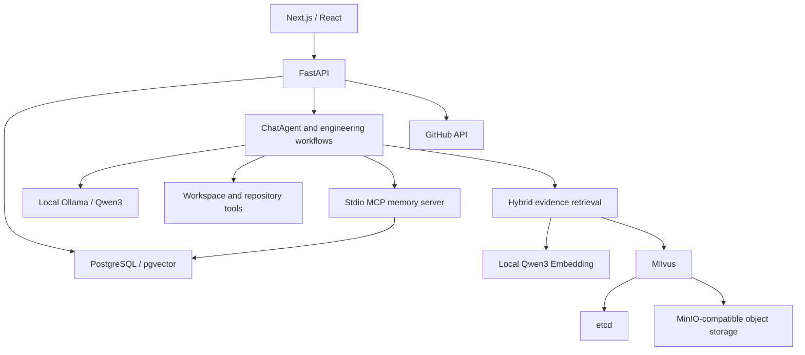

# DevFlow AI

DevFlow AI is a full-stack engineering assistant for GitHub repositories. It combines repository synchronization, native LLM tool calling, local workspace search, retrieval-augmented generation, persistent conversation memory, and engineering review workflows.

The local setup uses **Ollama `qwen3:8b`**, a **32,768-token model context**, and a **24,000-token project input budget**. No paid generation API key is required.

## Features

- Synchronize issues, pull requests, changed files, review comments, workflow runs, jobs, and CI logs.
- Analyze issue priority and complexity, review PR risks and test coverage, investigate CI failures, and generate engineering reports.
- Let ChatAgent choose tools for workspace files, repository data, RAG, conversation memory, and engineering workflows.
- Run Planner → Specialist Agents → Observer → Synthesis workflows with traceable intermediate results.
- Load task-specific skills with tool restrictions, version tracking, and execution validation.
- Upload TXT, Markdown, PDF, DOCX, JSON, CSV, and log files into knowledge bases.
- Retrieve evidence with vector and keyword search, rerank candidates, and generate answers with numbered citations.
- Preserve progressive conversation memory through the included stdio MCP memory server.
- Evaluate retrieval and agent behavior with fixed suites and RAGAS metrics.
- Prepare proposed GitHub changes as reviewable action drafts.

## Architecture



**Backend:** Python 3.11, FastAPI, Pydantic, SQLAlchemy, httpx, LangChain, LangGraph, RAGAS.

**Frontend:** Next.js 15, React 19, TypeScript, Tailwind CSS, React Query.

**Local services:** Ollama, PostgreSQL, Milvus, etcd, and Silo (a MinIO-compatible object store). Redis is an optional Compose profile and is not required by the application.

## Requirements

- Windows PowerShell and Python 3.11.
- Node.js 22 LTS with npm, installed normally or under `.tools/node-*-win-x64/`.
- Docker Desktop running Linux containers.
- Ollama with `qwen3:8b` installed.
- Internet access for initial dependency, container image, and embedding model downloads.

No additional Codex plugin is needed to run the application. The memory MCP server is included and starts automatically when memory tools are called. GitHub access uses `GITHUB_TOKEN` or a token supplied when connecting a repository.

## Installation

From the repository root:

```powershell
Copy-Item .env.example .env
py -3.11 -m venv backend/.venv
& ./backend/.venv/Scripts/python.exe -m pip install -r backend/requirements.txt -r backend/requirements-local-embedding.txt
cd frontend
npm ci
npm run build
cd ..
```

The Qwen3 embedding model is downloaded from Hugging Face on first use. It is separate from the Qwen3 chat model served by Ollama.

## Ollama configuration

Confirm that Ollama is running and the model is installed:

```powershell
ollama list
# If missing:
ollama pull qwen3:8b
```

Set the root `.env` to:

```dotenv
LLM_API_KEY=ollama
LLM_BASE_URL=http://localhost:11434/v1
LLM_MODEL=qwen3:8b
LLM_TIMEOUT_SECONDS=180
LLM_REASONING_EFFORT=none
RAG_LLM_ENABLED=true
PROMPT_CACHE_ENABLED=false
CONTEXT_MAX_INPUT_TOKENS=24000
CONTEXT_DYNAMIC_MODEL_WINDOW_ENABLED=false
CONTEXT_MODEL_WINDOW_TOKENS=32768
CONTEXT_RESERVED_RESPONSE_TOKENS=3000
```

`ollama` is a placeholder that enables existing clients; the local server ignores it. Keep `/v1` in the base URL. `LLM_REASONING_EFFORT=none` disables Qwen3 thinking output for ordinary generation and ChatAgent calls. Leave it unset to retain default model behavior. See the [Ollama OpenAI compatibility documentation](https://docs.ollama.com/api/openai-compatibility).

Set the Ollama server context length to 32K and restart Ollama after changing its server configuration. After a model request, use `ollama ps` to confirm that the running `qwen3:8b` has a 32,768-token context. The application context setting does not change the Ollama server context.

If a server-wide context setting is unavailable, the included Modelfile provides an alternative:

```powershell
ollama create devflow-qwen3:8b -f ./scripts/ollama/qwen3.Modelfile
```

Then set `LLM_MODEL=devflow-qwen3:8b`. This reuses the installed weights with an explicit 32K context.

Generation and ChatAgent use `LLM_TIMEOUT_SECONDS`. The RAGAS judge uses `RAGAS_TIMEOUT_SECONDS` and defaults to the same endpoint, API key placeholder, and model unless `RAGAS_JUDGE_*` overrides them. Judge reasoning behavior remains separate from ChatAgent configuration.

## Run the complete application

After installing dependencies and building the frontend:

```powershell
./scripts/start_project.ps1
```

The launcher starts PostgreSQL, etcd, object storage, and Milvus, waits for service readiness, and launches the backend and production frontend in the background. Logs and process information are saved in `.data/`.

| Service | Address |
| --- | --- |
| Application | http://localhost:3000 |
| Backend health | http://127.0.0.1:8000/health |
| Interactive API documentation | http://localhost:8000/docs |
| Object storage console | http://localhost:9001 |
| Ollama | http://localhost:11434 |

Stop the application processes:

```powershell
./scripts/stop_project.ps1
```

Stop infrastructure while retaining persistent data:

```powershell
docker compose stop
```

For frontend development, stop the production frontend and run `npm run dev` in `frontend`. Development artifacts use `.next-dev`; production builds use `.next`.

## Connect a repository

Open the application and connect a GitHub URL or an `owner/repo` identifier. Private repositories require a GitHub token. Set `GITHUB_TOKEN` in local `.env` or provide a repository-specific token in the connection form. Configure local workspace access during connection.

Initial synchronization fetches a small sample. Manual synchronization fetches all pages by default; an explicit `limit` caps total records per source. Status distinguishes complete, empty, partial, failed, and skipped synchronization. Failed requests preserve existing records, and incomplete data prevents unjustified health conclusions.

The UI supports repository conversations, document uploads, retrieval tests, agent chat, action drafts, and evaluation results.

## Local RAG

The complete local setup uses:

```dotenv
EMBEDDING_PROVIDER=qwen_local
EMBEDDING_MODEL=Qwen/Qwen3-Embedding-0.6B
LOCAL_EMBEDDING_MODEL=Qwen/Qwen3-Embedding-0.6B
EMBEDDING_DIMENSIONS=1024
MILVUS_ENABLED=true
MILVUS_URI=http://localhost:19530
MILVUS_COLLECTION=devflow_rag_qwen1024
```

Local embedding requires `requirements-local-embedding.txt`. Heuristic reranking is available locally. Optional hosted Qwen reranking requires `DASHSCOPE_API_KEY` or `RERANK_API_KEY`, plus `RERANK_BASE_URL`; local RAG does not require this paid integration.

Issue descriptions, PR discussions, failed CI logs, documents, and approved long-term knowledge are retrieval sources. Current code is read through workspace tools. Live statuses and structured reports come from authoritative APIs or database records.

Missing embedding dependencies and unavailable vector storage are reported explicitly. The separate `scripts/start_rag.ps1` launcher uses SQLite and deterministic demo embeddings with Milvus disabled; it demonstrates the UI and keyword retrieval, not complete vector RAG. Add `-UseConfiguredLLM` to enable model generation in that demo.

Useful routes include:

```text
POST /api/repos/connect
GET  /api/repos
GET  /api/rag/models
GET  /api/rag/repositories
POST /api/rag/repositories/{repo_id}/documents
POST /api/rag/repositories/{repo_id}/retrieval-tests
GET  /api/rag/{repo_id}/status
POST /api/rag/{repo_id}/search
POST /api/rag/{repo_id}/ask
POST /api/rag/{repo_id}/reindex
```

Rebuild affected indexes after changing embedding spaces or retrieval source boundaries. Do not mix incompatible embeddings in a collection.

## Verification

Check text, JSON, streaming, and a native tool-call round trip:

```powershell
& ./backend/.venv/Scripts/python.exe ./scripts/check_ollama.py
```

Run backend tests:

```powershell
cd backend
& ./.venv/Scripts/python.exe -m pytest app/tests -q
```

The test profile uses SQLite and fake model/vector clients, and isolates tests from local credentials and the configured Ollama context window.

Build the frontend:

```powershell
cd frontend
npm run build
```

The `/evals` page runs isolated ChatAgent conversations against a fixed suite and reports retrieval precision and recall, faithfulness, answer relevancy, goal accuracy, and tool-call diagnostics. Execution errors are distinct from quality failures. Baseline cases require their referenced documents to be indexed first.

## Configuration and data

`.env.example` documents configuration. `.env`, tokens, virtual environments, downloaded tools, uploads, local databases, and runtime logs are excluded from Git. Docker volumes retain infrastructure data. Repository-specific tokens are encrypted before storage; set a private `TOKEN_ENCRYPTION_KEY` for your installation.

See `docs/architecture/` and `docs/api/` for design and API notes.
